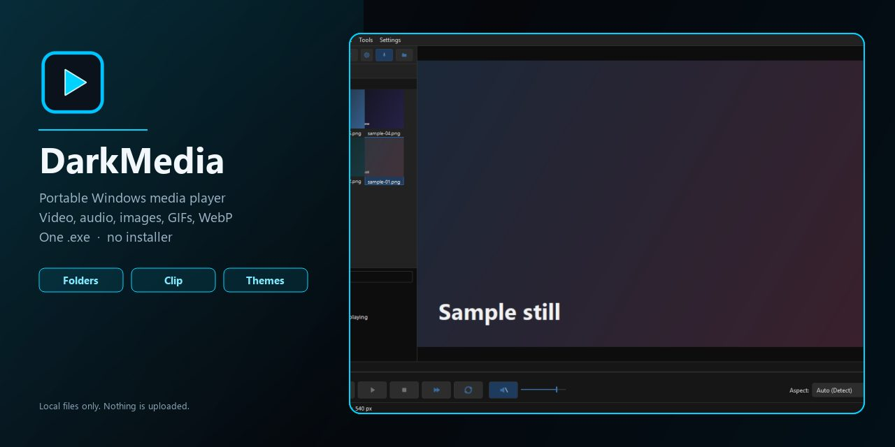
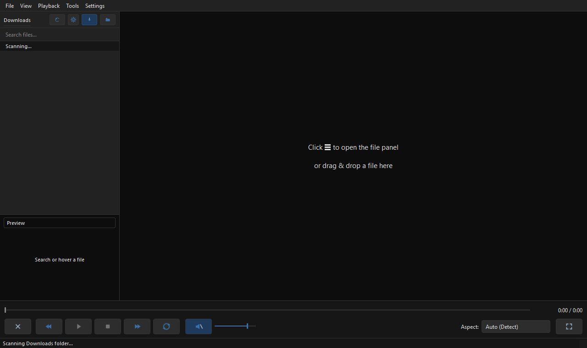
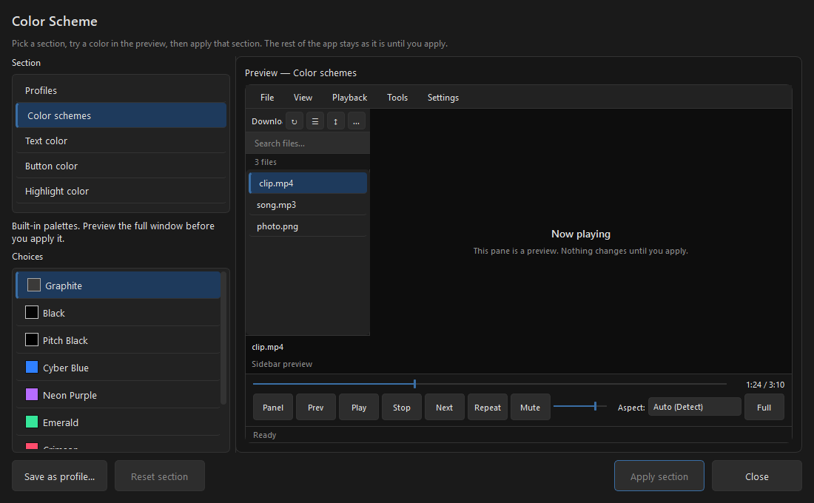

<p align="center">
  
</p>

<h1 align="center">Dark Media Viewer</h1>

<p align="center">
  A portable Windows player for <strong>video, audio, images, GIFs, and animated WebP</strong>.<br>
  One <code>DarkMedia.exe</code>. No installer. No Python. Nothing to set up.
</p>

<p align="center">
  <a href="https://github.com/Jew4200/DarkMedia-releases/releases/latest"><strong>Download the latest DarkMedia.exe</strong></a>
</p>

<p align="center">
  
</p>

Dark Media Viewer is a dark, local media player. You download one file, double-click it, and play. FFmpeg and **libmpv** are bundled inside the exe, so formats like AV1, HEVC, TrueHD, MIDI, and tracker modules work without extra codecs.

---

## What it looks like

| First open | Color Scheme |
| --- | --- |
|  |  |

The chrome stays out of the way: a dark window, a collapsible file panel, and playback controls along the bottom. Icon View shows folder thumbnails; Name View is a compact list. Hover a file in the sidebar to preview it before you open it.

---

## What it can do

- **Open a file or a whole folder.** The sidebar lists that folder. Files that are currently hidden in Windows stay hidden.
- **Play video and audio** with seeking, remembered volume, loop, skip back/forward, and track picking (audio, video, subtitles).
- **View stills, GIFs, and animated WebP.** Hold right-click over a spot and scroll to zoom into that location. Drag to pan. Rotate still images from the View menu.
- **Clip Video** with green start / red end markers, or **Clip Video 20mb Cap** for a linked window that stays under 20 MB. Clips save next to the original, same type.
- **Color Scheme** editor with a live preview. Built-in looks include Graphite, Black, Pitch Black, Cyber Blue, Neon Purple, Emerald, Crimson, and Amber. Save your own profiles.
- **Set as Default Player** for the video, audio, image, and GIF types it handles, or **Uninstall** from Settings / Apps & Features.
- **Always Open in Windows Fullscreen** (normal maximized window) and **Auto Replay on Launch**. F11 is still cinema watch-mode.
- **Check for Updates** from Settings. The app does not talk to the network unless you press that button.

Copy the exe anywhere. Settings and logs live in `%LOCALAPPDATA%\DarkMedia`, not next to the player. There is no media cache. Uninstall removes the settings folder too.

---

## Get it

1. Download **DarkMedia.exe** from the [latest release](https://github.com/Jew4200/DarkMedia-releases/releases/latest).
2. Double-click it.
3. Optional: **Settings → Set as Default Player** if you want Windows to open media with it.

Windows SmartScreen may warn because the exe is not code-signed. Choose **More info → Run anyway**.

Every release also ships `DarkMedia.exe.sha256`. To check a manual download:

```powershell
Get-FileHash .\DarkMedia.exe -Algorithm SHA256
```

The in-app updater does this automatically and refuses a file whose hash does not match.

---

## Formats

Playback is libmpv. Stills such as AVIF, HEIC, JPEG XL, and TIFF keep a color-managed path instead of being flattened to 8-bit sRGB.

| Kind | Examples |
| --- | --- |
| Video | MP4, MKV, WebM, AVI, MOV, TS/M2TS, WMV, FLV, MPEG, HEVC, AV1, VP9, VOB |
| Audio | MP3, FLAC, AAC, M4A, Opus, OGG, WAV, WMA, TrueHD, DTS, MIDI, tracker modules (IT, XM, S3M, MOD) |
| Images & motion | JPG, PNG, WebP, GIF, AVIF, HEIC, JPEG XL, TIFF, BMP, SVG |

Hundreds of related extensions are registered the same way (including aliases such as `jpg_large`). If Windows can hand the file to a player, Dark Media Viewer is meant to take it.

---

## Updating

**Settings → Check for Updates…**

The player asks GitHub whether a newer release exists, shows the notes, downloads the new exe, verifies the published SHA-256, swaps itself, and restarts. The previous exe is kept until the next launch.

---

## Privacy

No accounts, no telemetry, no analytics, no background network activity.

An update check is one unauthenticated HTTPS GET to GitHub with `User-Agent: DarkMedia/<version>` and nothing else — no account name, machine name, or file paths. GitHub still sees the connecting IP address, which is true of any download.

---

## Source

This repository only holds **downloads**, checksums, and this page. The source lives in a separate private repository.
